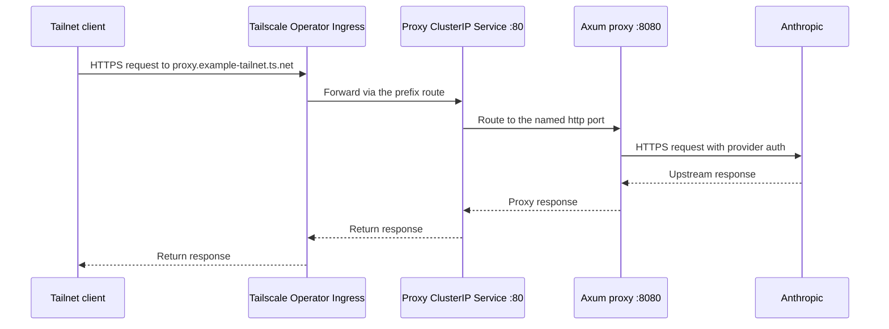
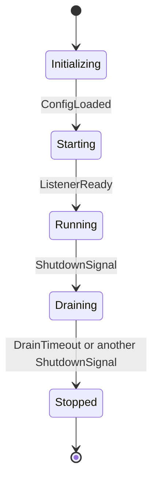

`anthropic-oauth-proxy` is a single Tokio/Axum binary. It owns upstream request forwarding, serves health and metrics on the proxy listener, and can run an OAuth account-management listener in the same process. The Tailscale Operator, not the binary, owns tailnet exposure.

## Startup: from config to listeners

[`main`](../../services/oauth-proxy/src/main.rs) sets up JSON logging (`LOG_LEVEL`, then `RUST_LOG`, then `info` as the filter fallback) and installs the Prometheus recorder before serving. `OTEL_EXPORTER_OTLP_ENDPOINT` separately enables batched OTLP trace export over gRPC; it is not required for `/metrics`.

1. **Pick one TOML file.** `--config <path>` wins over `CONFIG_PATH`, which wins over `anthropic-oauth-proxy.toml` in the working directory. This is path selection, not a merge of files. After TOML deserialization, `CREDENTIAL_FILE` replaces `oauth.credential_file` only if `[oauth]` exists. It neither selects OAuth nor makes the TOML field optional.
2. **Validate before listening.** The file must be readable and deserialize with the required `[proxy]` fields, including a socket address and upstream URL. [`Config::load`](../../services/oauth-proxy/src/config.rs) rejects non-HTTP(S) or unparseable upstream URLs, zero `timeout_secs` or `max_connections`, invalid names or values in active static headers, and, in OAuth mode, an empty credential path or zero cooldown, refresh interval, or refresh threshold. A present `[oauth]` selects OAuth even if `[[headers]]` is also present: the loader warns and clears those headers before validating header syntax. Without `[oauth]`, passthrough works even with no static header entries.
3. **Assemble the provider and bind.** The binary builds a reusable `reqwest::Client` with a 5-second connect timeout, distinct from the configured proxy timeout. In passthrough mode, `PassthroughProvider` applies configured headers without overwriting `Authorization`, leaves the body opaque to the provider, and has no account failover. In OAuth mode, the binary loads a JSON `CredentialStore` and builds a pool from `oauth.providers`, or from every stored account ID if that list is empty. A missing credential file is initialized as an empty store; failure to read, parse, or initialize the store is a startup error. The pool is shared by `AnthropicOAuthProvider` and a background task that periodically refreshes tokens nearing expiry. The proxy's per-request failover budget is set at startup from the initial ID count, with a minimum of one; it is not recalculated when an account is enrolled. Failure to bind the main proxy listener aborts startup.

[`Provider`](../../crates/provider/src/lib.rs) is the extension boundary for upstream auth: the router does not choose credentials per request. The proxy asks the selected provider whether it needs JSON, delegates request preparation and upstream error classification/reporting, and gets provider-specific status for `/health`. The OAuth implementation selects a pool account, replaces client auth with its Bearer token, and can rewrite request JSON. See [Proxy request workflow](../workflows/proxy-request.md) for timeout, streaming, and failover behavior.

## Traffic boundaries in the committed deployment

*Tailnet data path for an upstream request. The hostname is a placeholder, and the admin listener is not on this path.*

| Surface | Where it lands | What it does |
| --- | --- | --- |
| Data | [`tailscale` Ingress](../../k8s/ingress.yaml), prefix `/` → plain [proxy ClusterIP Service](../../k8s/service.yaml) `:80` → pod `:8080` | The Axum fallback proxies to the configured upstream (`https://api.anthropic.com` in the committed config). `max_connections` limits concurrent fallback handling, not the whole listener. |
| Monitoring | Same proxy listener `:8080`; startup, readiness, and liveness probes use `/health`, and pod annotations advertise `/metrics` to Prometheus | `GET /health` returns HTTP 200 with JSON status, mode, uptime and counters, plus pool details in OAuth mode. It does not prove upstream reachability or usable accounts: an empty pool can report `unhealthy` with HTTP 200 while a valid proxy request fails with 503. `GET /metrics` renders Prometheus text. Both routes bypass the fallback concurrency limit and are also reachable through the Ingress prefix route, subject to tailnet access. |
| Admin | Separate [admin ClusterIP Service](../../k8s/admin-service.yaml) `:9090` → separate Axum router on pod `:9090`; no Ingress backend | Lists accounts and pool state, enrolls accounts via PKCE, and removes accounts. These handlers share the live OAuth pool with the proxy. The router does not add request authentication, so restrict network access and use an authorized `kubectl port-forward` for operator work. The proxy router does not mount the admin handlers; an `/admin/...` URL sent there hits the upstream fallback, not the local admin API. |

The admin listener starts only inside the OAuth branch and only with `[admin].enabled = true` (default `false`; default address `0.0.0.0:9090`). It starts in its own task. A bind failure is logged without taking down the main listener, so a green proxy probe does not imply admin is reachable. See [OAuth enrollment](../workflows/oauth-enrollment.md).

The [Kustomize configuration](../../k8s/kustomization.yaml) generates a ConfigMap from [`k8s/config.toml`](../../k8s/config.toml). The [Deployment](../../k8s/deployment.yaml) points `CONFIG_PATH` at its read-only mount and mounts the credentials PVC at `/data`. The committed TOML enables `[oauth]` and `[admin]`, uses `/data/credentials.json`, and leaves `providers = []` to load all persisted accounts at startup. The remaining `[[headers]]` stanza does not make this a passthrough deployment. The Deployment uses one replica with `Recreate` and a six-second pod termination grace period.

The [spec index](../../specs/README.md) marks the original Operator exposure plan as historical. The [Operator addendum](../../specs/operator-migration-addendum.md) explains why the Ingress owns the tailnet hostname: leaving the old Service expose annotations in place created a second proxy device claiming the same name. The committed pod has no `tailscaled` sidecar, and neither ClusterIP Service carries those exposure annotations.

## Lifecycle model versus real shutdown

[`handle_event`](../../services/oauth-proxy/src/service.rs) is an I/O-free state model. `main` uses its startup transitions: `ConfigLoaded` produces `Starting` and `StartListener`, and a successful bind leads to `ListenerReady` and `Running`. The model also defines shutdown transitions, but they are not the runtime drain mechanism. Request events are no-ops in the model; handlers update shared counters directly.

*Main path through the service state model. Only the startup transitions in this diagram are dispatched by the binary.*

In production, SIGINT or Unix SIGTERM causes `main` to send a one-shot notification to Axum's `with_graceful_shutdown`. Axum stops accepting new connections and drains existing work. The five-second deadline starts at signal receipt, when `main` begins waiting for the proxy server task. On timeout it logs the in-flight handler count and proceeds toward exit; it does not poll the counter for zero. In particular, the handler counter can drop once a streaming response is handed to Axum, before its body finishes. The admin server and refresh task are not part of that drain. After the proxy drain wait, `main` calls shutdown on the optional OpenTelemetry tracer provider to flush buffered spans; exporter shutdown has its own timeout and is not covered by the five-second proxy drain budget.

## Checks when changing this boundary

- Config tests cover CLI-over-env path selection, required fields and invalid values, OAuth precedence, and the credential-file override.
- Router tests exercise a slow upstream with one proxy slot to check the monitoring bypass, and verify that OAuth health includes pool details. The admin-router test checks that `/v1/messages` returns 404 on the admin router; it is not an Ingress test.
<!-- openwiki: broken internal link [../operations/diagnose-the-proxy.md] file "../operations/diagnose-the-proxy.md" does not exist. Fix the href or restore the target, then delete this comment. -->
- State-model tests exercise the drain timeout, redundant shutdown, and terminal `Stopped` behavior. They do not send OS signals or test exporter flush. Check live routing and rollout behavior separately using [Deploy and roll back](../operations/deploy-and-roll-back.md) and [Diagnose the proxy](../operations/diagnose-the-proxy.md).
