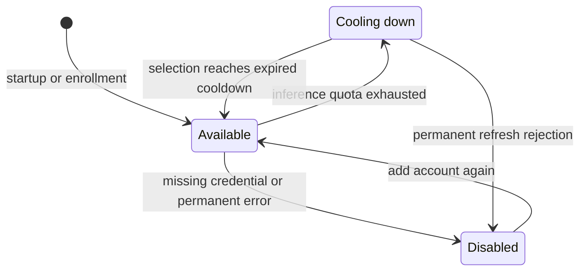

The pool decides **which account can serve a request**; the credential store supplies **which tokens that account uses**. The proxy constructs the pool only in `[oauth]` mode. `AnthropicOAuthProvider` calls `Pool::select` during request preparation, replaces client `Authorization` and `x-api-key` headers with the selected OAuth Bearer credential, and returns the account ID so the proxy can attribute upstream errors. Passthrough mode does not use the pool. See the [proxy request workflow](../workflows/proxy-request.md) for the rest of the forwarding path.

## Startup and pod replacement

| State | What happens when the pod is replaced |
| --- | --- |
| Credential JSON | With the same PVC, the new process loads the last successfully written JSON at `/data/credentials.json` in the [shipped config](../../k8s/config.toml). The map is keyed by account ID and stores `type` (`oauth`), `access`, `refresh`, and `expires`. `expires` is an absolute Unix timestamp in **milliseconds**, computed from a clock reading plus `expires_in * 1000`, not a seconds delta. |
| Pool membership and status | Startup takes `[oauth].providers` if nonempty; otherwise it uses all stored IDs. This is an initial list, not a filter on live enrollment. Each member starts `Available`, and the round-robin cursor starts over. Cooldown deadlines and `Disabled` status do **not** survive replacement. With explicit providers, a newly enrolled ID not in the list won't rejoin on restart, and a deleted ID still listed in config is initially included even if its credential is gone. |
| Pending PKCE enrollment | The admin server stores the pending account ID and verifier in memory by OAuth `state`. Completion consumes the entry before exchanging the code; the entry is subject to a 10-minute age check. If the pod is replaced mid-flow, start [enrollment](../workflows/oauth-enrollment.md) again. |

On a cold start, a missing credential file is created as `{}`. With the shipped empty `providers` list, that means zero members: pool health is `unhealthy` and selection fails until an account is added. An existing unreadable or malformed file fails startup rather than being treated as empty. `CREDENTIAL_FILE` can override the path; replacement only preserves credentials if the effective path is on persistent storage that the new pod mounts. The Kubernetes deployment uses one replica with `Recreate` and mounts the [`ReadWriteOnce` credential claim](../../k8s/pvc.yaml) at `/data`. See [deploy and roll back](../operations/deploy-and-roll-back.md).

## Selection and account status

*Figure: Normal transitions for an account in the running pool. Deletion removes the member rather than changing its status.*

`Pool::select` advances an atomic cursor once per call and scans at most one lap from that starting position. It skips disabled members, missing status entries, and unexpired cooldowns. When it reaches an expired cooldown, it marks the account available and continues evaluating it. It reads the current credential from the store; a missing credential disables that member and the scan moves on. If no candidate can supply a token, selection returns `PoolExhausted` with counts, which the proxy surfaces as HTTP 503.

Health reports status, not token usability. `/health` returns HTTP 200 even when its JSON says `unhealthy`; `/admin/pool` exposes the same pool summary. All members available means `healthy` for a nonempty pool, some means `degraded`, and none means `unhealthy`. Health does not promote an expired cooldown: it can still show `cooling_down` with zero seconds remaining until selection visits the member. Exhaustion counts, unlike health, count elapsed cooldowns as available without changing status. An `available` count is not proof that selection can obtain a token.

### Inference responses: quota versus throttling

The OAuth provider's inference classifier checks a 429 body for case-insensitive substrings such as `5-hour`, `5 hour`, `rolling window`, `usage limit for your plan`, or `subscription usage limit`. A match is `QuotaExceeded`: the pool sets a local cooldown of `cooldown_secs` (7,200 seconds as shipped), and the proxy can select again and resend. This delay is configured, not derived from an upstream reset time. A generic 429 is transient and is returned without cooldown, account failover, or a retry of that response. Inference 401/403 disables the account and returns the error immediately, without trying another account on that request.

The inference-attempt budget for quota failover is the **startup** membership count, at least one; admin changes don't resize it. If the final attempt gets a quota 429, that response is returned. If another attempt is allowed but cannot select an account, the response is 503 instead.

## Two paths to the token endpoint

Both paths POST a refresh-token grant to `https://platform.claude.com/v1/oauth/token`, separate from the inference upstream. The thresholds answer different questions:

| Path | When it refreshes | On a transient refresh failure |
| --- | --- | --- |
| Request-time selection | A selectable account's access token is expired or expires within a hard-coded **60 seconds**. Selection waits for the refresh and uses the new access token if it succeeds. | Skip this candidate for this scan, without disabling it or falling back to its old access token. |
| Background task | After skipping the immediate first tick, scan a snapshot of **all current pool IDs**, including cooling and disabled members, not every ID in the credential file. Skip missing credentials and tokens outside `refresh_threshold_secs`. The shipped interval is **300 seconds** and the threshold is **900 seconds**. | Leave status unchanged; an eligible account can be retried on a later cycle. |

For a non-success refresh response, HTTP 401/403 or a top-level JSON `error` of `invalid_grant` (including HTTP 400) is permanent. Both paths mark the account `Disabled`; inline selection continues scanning. Other failures, such as transport errors, 429, 5xx without `invalid_grant`, and malformed success responses, are transient. A token-endpoint 429 does not go through inference quota classification. A successful background refresh does not clear a cooldown or re-enable a disabled account.

## What a successful refresh saves

Both paths update the credential store with the returned access token, returned refresh token (including rotation), and recomputed expiry. The [store](../../crates/anthropic-auth/src/credentials.rs) holds a process-local mutex over the map mutation and full-file write: it writes a temporary file in the same directory, sets Unix permissions to `0600`, then atomically renames it over the target. Reads also take the mutex to snapshot credentials. This serializes store access, **not refresh HTTP calls**: requests and the background task can read the same refresh token and call the endpoint concurrently. It is not cross-process coordination.

The store mutates memory **before** persisting and does not roll back on a write error. Inline refresh logs a persistence failure but still returns the new access token; background refresh logs the failure but still records refresh success. The running process can therefore use a rotated token while the replacement pod reloads the older on-disk token. Enrollment adds the credential before adding the member: a failed save returns an error and skips pool insertion. Deletion does the reverse: it removes the member first, then attempts to delete its credential, logging a persistence failure but still reporting removal. A credential left on disk can reappear on restart when membership is drawn from stored IDs.

<!-- openwiki: broken internal link [../operations/diagnose-the-proxy.md] file "../operations/diagnose-the-proxy.md" does not exist. Fix the href or restore the target, then delete this comment. -->
For investigation, distinguish `pool_token_refreshes_total` and refresh persistence warnings from inference quota errors. See [diagnose the proxy](../operations/diagnose-the-proxy.md).

## Focused tests

- [Pool tests](../../crates/anthropic-pool/src/pool.rs) exercise round-robin order, cooldown and disabled skips, lazy cooldown expiry, and missing credentials. The expired-token test calls the real token endpoint and asserts selection moves on after failure, not that the resulting status is always `Disabled`.
- [Quota tests](../../crates/anthropic-pool/src/quota.rs) and [token error tests](../../crates/anthropic-auth/src/token.rs) cover the two classifiers independently. The [proxy tests](../../services/oauth-proxy/src/main.rs) use a local upstream to check quota 429 followed by success and that an inference 401 returns after one call.
- [Credential store tests](../../crates/anthropic-auth/src/credentials.rs) cover cold-start file creation, save/load round-trip, and concurrent writes within one shared store. They do not test serialization of refresh HTTP calls.
