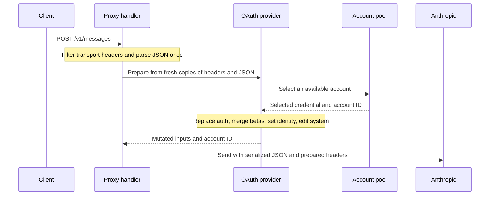

For changes to what OAuth mode sends upstream on `POST /v1/messages`, start at [`AnthropicOAuthProvider::prepare_request`](../../services/oauth-proxy/src/provider_impl.rs). This is the mutation boundary: it owns credential replacement and compatibility edits; the [proxy handler](../../services/oauth-proxy/src/proxy.rs) owns HTTP forwarding and retries. A request that passes the local contract can still be rejected by Anthropic, and a live HTTP 200 does not tell you which plan paid for it.

## Where the contract applies

At startup, `[oauth]` selects the pool-backed provider and takes precedence over `[[headers]]`, as in the [committed Kubernetes config](../../k8s/config.toml). Without `[oauth]`, [`PassthroughProvider`](../../crates/provider/src/passthrough.rs) injects valid configured headers without injecting or overwriting `Authorization`; it does not select an account or modify the body. In particular, static `anthropic-beta` injection replaces an existing value in passthrough mode rather than merging it. See the [client runbook](../../docs/runbook/clients.md) for mode and client setup.

*The successful OAuth path separates HTTP forwarding from account selection and request mutation.*

The handler drops hop-by-hop headers, `Host`, and `Content-Length` before preparation. The outbound HTTP client sets the host from the upstream URL and determines the length from the new body, not from the original JSON's byte count. Invalid JSON in OAuth mode returns 400 before account selection; a preparation error, such as no available account, returns 503 rather than forwarding with the client's credentials. The pool selects round-robin among usable accounts and can refresh a near-expiry token inline. A quota-classified upstream failure puts the selected account into cooldown and starts the next failover attempt from the original filtered headers and parsed JSON; transport timeout retries within an attempt reuse the prepared request. See [Proxy Request](../workflows/proxy-request.md) for the full lifecycle.

## What the OAuth provider changes

| Input or header | Outbound contract |
| --- | --- |
| `Authorization`, `x-api-key` | Remove both client credentials. Set `Authorization` to a Bearer credential from the selected pool account; do not forward `x-api-key`. Clients should not supply a real Anthropic API key to the OAuth gateway. |
| `anthropic-beta` | Start with the ten entries in `REQUIRED_BETA_FLAGS`, then append unique client flags in encounter order. The implementation reads one header value with `HeaderMap::get`, splits it on commas, trims whitespace, ignores empty entries, and writes a single comma-separated value. It does not gather separately repeated header fields or merge flags from the body. |
| `user-agent`, `x-app` | Overwrite with `claude-cli/2.1.280 (external, sdk-cli)` and `cli`, respectively. |
| `anthropic-version`, `anthropic-dangerous-direct-browser-access` | Overwrite with `2023-06-01` and `true`, respectively. |
| `x-anthropic-billing-header` | Strip any client value and do not inject a replacement. The proxy does not synthesize the attribution block observed in genuine Claude Code. |

The identity and version values are source constants, not settings supplied by generic clients. The forced beta set mirrors the ten flags captured from Claude Code 2.1.198; the two additional flags seen in 2.1.280 are not forced. Check the [beta audit](../../docs/audits/anthropic-beta-flags.md) before adding a flag: a forced flag applies to all OAuth clients, and acceptance alone does not rule out response-shape changes.

### System messages and client-specific behavior

`inject_system_prompt` uses `REQUIRED_SYSTEM_PROMPT_PREFIX` whenever `model` is a string, including for Haiku. A missing `system` becomes an array with one prefix text block. A string becomes an array, with a separate prefix block only if the string does not already start with the prefix. An array keeps its blocks and metadata, including `cache_control`; the code checks **any** text block for the prefix at the start of its text before deciding whether to prepend it. Missing or non-string `model` skips prefix injection, and a `system` value that is neither a string nor an array is left alone.

Next, the Pi sanitizer checks only `system` strings and text blocks, not the user messages or tools. It removes the recognized Pi documentation-routing hint. For Pi 0.87.1's tagged shape it removes the matching `<docs>` element while keeping surrounding sections such as `<cwd>` and extension notes. For the older bare paragraph it retains the preceding text and the subsequent `Current date:` and `Current working directory:` lines, not the rest of the tail. Unmatched text is unchanged. If Pi alone starts getting an extra-usage 400 while a minimal client works, check the client version and whether the hint still matches before changing identity headers. The [client runbook](../../docs/runbook/clients.md) covers Pi's client-shaping placeholder and the observed prompt-layout regression; its bullet about injecting the billing header predates the current stripping behavior.

The provider otherwise leaves the JSON values for model, messages, tools, parameters, and `stream` alone; this is not byte-for-byte preservation of the serialized body. The [generic-client spec](../../specs/generic-client-support.md) records a tool-name compatibility fix made **client-side** for Forgeflare. [OpenClaw tool rewriting](../../specs/openclaw-tool-rewrite.md) is a [deferred draft](../../specs/README.md), not a supported proxy profile or a guarantee that arbitrary tool sets are accepted.

## Validate the right thing

1. **Local mutation regression.** Run `cargo test -p oauth-proxy --test inc_2026_001_seam inc_2026_001_d002`. The [seam test](../../services/oauth-proxy/tests/inc_2026_001_seam.rs) calls the real provider twice with temporary stores and inert, non-expiring credentials. The [D002 fixture](../../services/oauth-proxy/tests/D002-fixture.json) is synthetic, not a traffic capture; it supplies an overlapping beta and a client-only beta. The test checks the ordered union, exact captured User-Agent, other fixed headers, credential replacement, billing-header absence, and whole-body equality apart from the expected `system` addition. It requires consistent observations across both runs. It does not send the request to Anthropic or exercise live SSE. For a sanitizer change, extend the provider's focused tests for tagged, legacy, and nonmatching shapes; the seam fixture has no Pi prompt. The service's local echo tests separately exercise forwarding through the handler, including billing-header stripping and beta merging. See [Validation](../testing/validation.md).
2. **Live acceptance and header parity.** Use the [header parity runbook](../../docs/runbook/header-parity.md) for re-capture and the [client runbook](../../docs/runbook/clients.md) for the affected client's smoke check. Compare the on-wire `user-agent`, not the debug attribution version, when investigating `claude_code_version_too_old`. The [provenance audit](../../docs/audits/header-provenance.md) records that for `claude-fable-5-1` in INC-2026-001, changing only the User-Agent cleared the 400; changing only the old billing version did not. Earlier debug attribution lines did not establish that the string was an HTTP header. The 2.1.280 capture found attribution in a `system` block instead, and a later live A/B got 200 both with and without the legacy header. That is why the proxy strips it instead of updating the old constant or copying the block.
<!-- openwiki: broken internal link [../operations/diagnose-the-proxy.md] file "../operations/diagnose-the-proxy.md" does not exist. Fix the href or restore the target, then delete this comment. -->
3. **Plan usage.** The live A/B showed acceptance, not how the request was billed. Treat the Pi extra-usage symptom as a separate observation about client shape, not as proof that a successful seam test or a 200 implies Max-plan usage. For failures, see [Diagnose the Proxy](../operations/diagnose-the-proxy.md).

For shared diagnostics, follow the seam test's example: keep only allowlisted public compatibility headers, status or error codes, and boolean protection checks. Use placeholders for deployment details; do not include credentials, full header maps, or request content in examples, logs, or shared captures.
