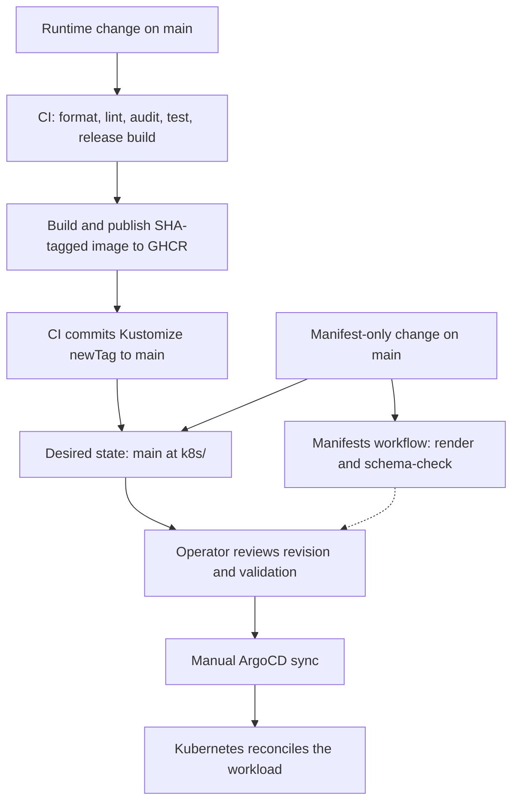

# Kubernetes Deployment, Promotion, and Rollback

**A green CI run makes a change eligible for deployment; it does not put that change into service.** Git defines the desired manifests, ArgoCD applies them when an operator syncs, and Kubernetes replaces the pod. Verify those steps separately.

## From change to promotion

*Runtime CI publishes a SHA-tagged image and updates Git; manifest-only CI validates without publishing an image. Both paths depend on an operator to promote the desired revision.*

- **Runtime changes.** The [runtime workflow](../../.github/workflows/ci.yml) gates the Docker job on formatting, Clippy, dependency audit, workspace tests, and a release build. Pull requests can build the image but do not push it. Qualifying pushes to `main` or `v*` tags publish to GHCR, but only a `main` push runs the tag-update job. That job writes `sha-<7char>` to `newTag` and pushes a `[skip ci]` commit if the tag changed. The image tag names the code commit, not the later Git revision that selects it. Kustomize substitutes that tag for the base Deployment's `:main`; leave `newTag` to CI.
- **Manifest-only changes.** A `k8s/`-only change does not run runtime CI. The [manifest workflow](../../.github/workflows/manifests.yml) runs `mise run k8s:validate`, which renders `k8s/` with `kubectl kustomize` and checks the result with `kubeconform`. It neither contacts the cluster nor publishes an image. Mixed runtime and Kubernetes changes can trigger both workflows. Review the rendered state and wait for the intended tag-update commit before promoting a mixed change meant to ship together.
- **Promotion.** The [runbook's sync procedure](../../docs/runbook/deployment.md#how-deployments-work) documents an externally owned ArgoCD Application tracking `main` at `k8s/` with no auto-sync. `OutOfSync` can be expected while a change awaits promotion. Use the documented manual sync, not an auto-sync policy change. For first-time setup or an intentional direct apply, use the [bootstrap procedure](../../docs/runbook/deployment.md#bootstrap-deploy); the public GHCR image does not require a pull secret. A fresh PVC still needs OAuth account enrollment before authenticated requests can succeed.

## What a rollout replaces—and what it keeps

The [Dockerfile](../../Dockerfile) builds the release `anthropic-oauth-proxy` binary and runs it directly as UID 1000. The [Deployment](../../k8s/deployment.yaml) mounts config read-only at `/etc/anthropic-oauth-proxy` and points `CONFIG_PATH` to the mounted `config.toml`. Change [k8s/config.toml](../../k8s/config.toml) in Git rather than editing a live ConfigMap. The [Kustomization](../../k8s/kustomization.yaml) generates a content-hashed ConfigMap name and rewrites the Deployment's volume reference. When a config change is synced, the new reference changes the pod template; the replacement process reads the file at startup rather than hot-reloading it.

- **Expect a brief interruption.** The Deployment has one replica and uses `Recreate`: on a template update, the old pod goes away before the new one comes up. Tailnet clients can see 502s until the replacement is ready. [Preserve the current pod's logs](../../docs/runbook/README.md#quick-reference) before syncing, restarting, or undoing a rollout.
- **Credentials outlive the pod, not the claim.** The separate [PVC](../../k8s/pvc.yaml) is `ReadWriteOnce` and mounted at `/data`. The proxy loads `/data/credentials.json` at startup, so pod replacement or rollback reuses the credentials that are on disk now; it does not restore an older credential snapshot. Keep the claim intact. In-progress PKCE enrollment is held in process memory, so a restart loses it and separate replicas cannot share it. See [Account Pool](../concepts/account-pool.md) and the [credential persistence runbook](../../docs/runbook/accounts.md#credential-persistence).
- **The drain has its own deadline.** On SIGTERM the main HTTP server stops accepting new connections and gets up to five seconds to finish serving existing work. If the drain times out, the proxy logs a warning and proceeds to shutdown, including an OpenTelemetry flush attempt if enabled. Kubernetes gives the pod six seconds total before forced termination. Increasing that Kubernetes grace period alone does not extend the app's five-second drain; long requests or streams can be cut off.
- **Probes check the listener, not OAuth usability.** Startup, liveness, and readiness all hit `/health` on port 8080. Startup gates the other probes; liveness can restart a failing container and readiness controls whether it receives Service traffic. `/health` bypasses the proxy concurrency limiter and returns HTTP 200 even if the OAuth pool is unhealthy. Read the JSON `status` and `pool`, and test a real request before declaring success.

## Verify the promoted release

1. **Git and ArgoCD:** Record the intended Git revision and rendered tag. After [manual sync](../../docs/runbook/deployment.md#how-deployments-work), check the sync operation succeeded at that revision. `Healthy` alone does not establish that the intended revision was synced.
2. **Deployment and pod:** Follow [rollout and startup verification](../../docs/runbook/deployment.md#verify-deployment). Compare the Deployment's template image with the rendered tag, then check the replacement pod is Ready and inspect its container image and image ID if you need to confirm what actually started. The template may already name the new image while the rollout is still incomplete.
3. **Client path:** Check `https://proxy.example-tailnet.ts.net/health` and read its body, then follow the [end-to-end request check](../../docs/runbook/deployment.md#end-to-end-test) with your deployment's HTTPS tailnet FQDN. Traffic goes through Tailscale Ingress to the proxy Service; it does not exercise the separate admin Service on 9090.

<!-- openwiki: broken internal link [./diagnose-the-proxy.md] file "./diagnose-the-proxy.md" does not exist. Fix the href or restore the target, then delete this comment. -->
[`mise run live:validate`](../../mise.toml) is an operator-side check that requires live access. It compares `origin/main`'s tag with the **Deployment template** image and reports the last ArgoCD sync revision and time. Tag drift is a warning, not a failing gate. The task also checks cluster objects, tailnet `/health`, a Pi smoke request, and recent Phoenix proxy spans. Offline checks cannot verify those: for example, the Rust test `health_and_metrics_bypass_concurrency_limit` tests probe responsiveness under proxy load, and `roundtrip_save_load` tests credential reload from disk, not a real PVC. See [Validation](../testing/validation.md), [Service Runtime](../architecture/service-runtime.md), and [Diagnose the Proxy](./diagnose-the-proxy.md).

## Reverse a bad rollout

| Situation | Action |
| --- | --- |
| Bad runtime change | Use the [Git rollback procedure](../../docs/runbook/deployment.md#rollback). Revert the offending code commit, not blindly `HEAD`, which may be the CI tag commit. Wait for CI to build and pin the revert commit's image, then manually sync. |
| Bad manifest or config change | Revert the offending change in Git, check the rendered manifests, then manually sync. A manifest-only revert does not need to rebuild the image. Check both the tag and config when reverting a mixed release. |
| Cannot wait for CI | Use the [emergency rollout undo](../../docs/runbook/deployment.md#rollback) if the previous Deployment revision and its dependencies are still available. Undo restores a prior pod template, not Git, other Kubernetes resources, or PVC contents. If that template references a generated ConfigMap, the old ConfigMap must still exist. Follow up with a Git revert: the next manual sync can overwrite the emergency undo with the state in `main`. |

Run the same revision, pod, and client checks after recovery. If the new pod is Ready but requests still fail, inspect pool health and the preserved logs before replacing it again; rolling back code does not repair expired credentials.
