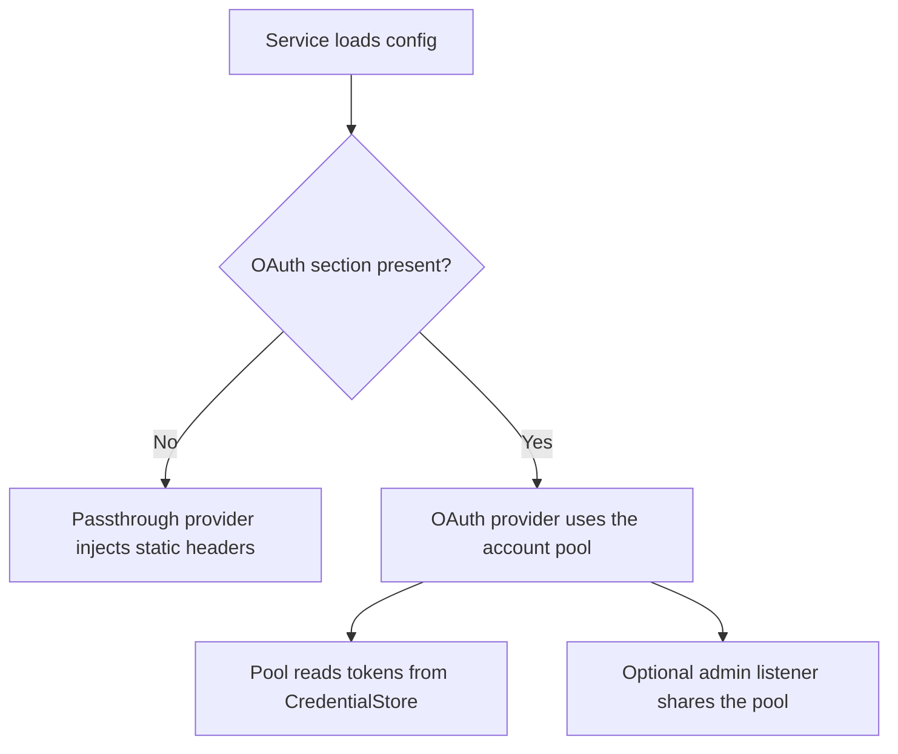

## First build and test

From the repository root, with stable Rust and Cargo:

```sh
cargo build --workspace
cargo test --workspace
```

The [workspace](../Cargo.toml) contains one service package and four supporting crates. Use `-p oauth-proxy` to select the [Cargo package](../services/oauth-proxy/Cargo.toml); its executable is `anthropic-oauth-proxy`, not `oauth-proxy`. The [mise setup](../mise.toml) selects stable Rust with `rustfmt` and `clippy`.

For a local start, copy the [sample config](../anthropic-oauth-proxy.example.toml). It binds to all interfaces by default; change `listen_addr` to `127.0.0.1:8080` before starting if you only want local access.

```sh
cp anthropic-oauth-proxy.example.toml anthropic-oauth-proxy.toml
# Edit listen_addr for local-only access before starting.
cargo run -p oauth-proxy --bin anthropic-oauth-proxy -- --config anthropic-oauth-proxy.toml
```

From another terminal, `curl -fsS http://127.0.0.1:8080/health` checks the local listener without forwarding a request to Anthropic. Read the JSON `status`, not just the HTTP status: `/health` returns 200 even for an unhealthy OAuth pool. The [config loader](../services/oauth-proxy/src/config.rs) resolves the path in order: `--config`, `CONFIG_PATH`, then `anthropic-oauth-proxy.toml`. The sample exercises static headers, not enrollment or managed credentials. The [cluster config](../k8s/config.toml) enables OAuth and admin; `[oauth]` takes precedence over `[[headers]]`.

## Who owns what


The config selects the provider, and only OAuth mode can start the account-management listener.

| Owner | What belongs there |
| --- | --- |
| [`services/oauth-proxy`](../services/oauth-proxy/src/main.rs) | Binary entrypoint, config validation, listener wiring, health and metrics, and shutdown. `proxy.rs` owns forwarding, retries, and streaming; `provider_impl.rs` owns Anthropic-specific request shaping; `admin.rs` owns enrollment orchestration. `/health` and `/metrics` bypass the proxy concurrency limit; admin runs on a separate listener. |
| [`common`](../crates/common/src/error.rs) | Shared configuration, I/O, and TOML parse errors used by the config loader. |
| [`provider`](../crates/provider/src/lib.rs) | Extension boundary for request preparation, error classification and reporting, and provider health. Its static passthrough implementation leaves the body untouched, refuses to overwrite `Authorization`, and has no pool. |
| [`anthropic-auth`](../crates/anthropic-auth/src/lib.rs) | PKCE helpers, token exchange and refresh calls, and `CredentialStore` for persistent token data. The admin handler persists a credential before adding its account to the pool. |
| [`anthropic-pool`](../crates/anthropic-pool/src/pool.rs) | Round-robin selection and in-memory cooldown/disabled state; inline refresh during selection and proactive background refresh. The configured credential file is on the PVC in Kubernetes; pool statuses are rebuilt at startup, not restored from that file. |

## Where to go next

| Task or symptom | Start here |
| --- | --- |
| Change startup, config, listener boundaries, or shutdown | [Service Runtime and Traffic Boundaries](architecture/service-runtime.md). See the config precedence tests in [`config.rs`](../services/oauth-proxy/src/config.rs) and `health_and_metrics_bypass_concurrency_limit` in [`main.rs`](../services/oauth-proxy/src/main.rs). |
| Change forwarding, timeouts, retries, or SSE | [Proxy Requests, Retries, and Streaming](workflows/proxy-request.md). The loopback regression `proxy_stream_idle_timeout_terminates_stalled_stream` checks that two SSE chunks arrive before a stalled stream terminates. |
| Change OAuth headers or generic-client JSON shaping | [Anthropic Request Contract and Client Compatibility](integrations/anthropic-client-contract.md). Run `cargo test -p oauth-proxy --test inc_2026_001_seam` for the local mutation regression with inert credentials; it does not test live upstream acceptance. |
| Change selection, refresh, or quota handling | [Account Selection, Quota, and Token Refresh](concepts/account-pool.md). Start with `cargo test -p anthropic-pool` for selection, cooldown, and quota classification checks; see `oauth_provider_quota_failover` in the service tests for forwarding across accounts. |
| Add or replace an account, or debug rejected PKCE state | [OAuth Enrollment and Account Replacement](workflows/oauth-enrollment.md). See the state rejection and consumption tests in [`admin.rs`](../services/oauth-proxy/src/admin.rs). |
<!-- openwiki: broken internal link [operations/diagnose-the-proxy.md] file "operations/diagnose-the-proxy.md" does not exist. Fix the href or restore the target, then delete this comment. -->
| Investigate `502`, `504`, `503 pool_exhausted`, or misleading green probes | [Diagnose Health, Pool, and Request Failures](operations/diagnose-the-proxy.md) and the [runbook](../docs/runbook/README.md). |
| Change Kubernetes config or exposure, promote an image, or roll back | [Kubernetes Deployment, Promotion, and Rollback](operations/deploy-and-roll-back.md). Start with [Kustomize](../k8s/kustomization.yaml): the Tailscale Ingress targets the proxy ClusterIP Service, not the separate admin Service. CI updating the image tag in Git is not a rollout; promotion requires an ArgoCD sync. |

## Automated checks vs. live smoke

- **Automated:** `mise run check` adds formatting and Clippy to build and test. `mise run k8s:validate` renders `k8s/` with Kustomize and checks the result with kubeconform without applying it. For telemetry changes, [`telemetry_tests.rs`](../services/oauth-proxy/src/telemetry_tests.rs) checks span metadata locally, not delivery to Phoenix. Some auth and pool tests do contact the real token endpoint with bogus inputs; these do not require enrolled accounts or a deployed proxy, but the full suite is not strictly offline.
- **Deployment-dependent:** `mise run live:validate` needs the deployed environment and kube/Tailscale access. It checks ArgoCD and image state, tailnet health reachability, a Pi proxy request, and recent OAuth proxy spans in Phoenix. The image mismatch is a warning, and the health request alone does not establish pool usability. Use [Automated Checks and Live Validation](testing/validation.md) to choose the right checks for your change.

## Which design docs to trust

Use the [spec status index](../specs/README.md) before following a spec. The OAuth gateway and generic-client specs describe current behavior but have drift; streaming timeout and OTLP tracing are implemented, and the operator migration addendum describes current exposure. The OpenClaw tool rewrite is a deferred draft. The old passthrough proxy spec, tailscaled sidecar design, and pre-addendum traffic exposure assumptions are historical. Passthrough mode itself still ships. When sources disagree, use the code and focused tests for behavior, `kubectl kustomize k8s/` for intended deployment wiring, and the runbook for operator procedures.
