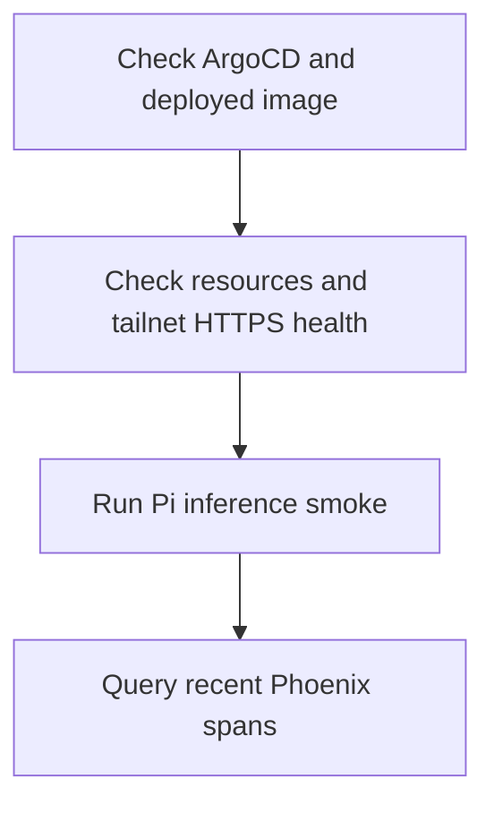

# Automated Checks and Live Validation

Start with the smallest check that can fail for the change. A local upstream can reproduce a quota response or a stalled stream without a real account; it cannot tell you whether Anthropic accepts the deployed request or whether Phoenix receives the span. Conversely, a live success does not exercise the failure cases pinned by local tests.

## Default tests: change-to-test matrix

Run from the repository root. For rows listing test names rather than commands, use `cargo test -p oauth-proxy <test-name>` with one filter per run. The [proxy HTTP tests](../../services/oauth-proxy/src/main.rs) commonly call the Axum router in process and use a real loopback connection to a fake upstream. They need permission to bind loopback sockets, not Kubernetes access or enrolled accounts.

| Change | Focused check | What a pass proves |
| --- | --- | --- |
| Forwarding, headers, or body | `proxy_injects_headers_and_forwards`, `proxy_forwards_request_body_to_upstream`, `proxy_query_string_forwarded_to_upstream`, `proxy_strips_hop_by_hop_from_response` | The loopback upstream sees the expected request mutations, body, and query; hop-by-hop response headers are not forwarded. |
| OAuth quota failover | `oauth_provider_quota_failover`, `oauth_provider_permanent_error_returns_immediately`, `oauth_provider_pool_exhausted_returns_503` | A quota-shaped 429 can lead to a second upstream call and success; an inference 401 returns after one call. Despite its name, the last test asserts that a one-account request returns the upstream **429** at the attempt limit, not that it returns 503. |
| Initial response timeout vs. stalled body | `proxy_retries_timeout_exactly_three_attempts`, `proxy_resends_body_on_timeout_retry`, `proxy_does_not_retry_non_timeout_errors`, `proxy_stream_idle_timeout_terminates_stalled_stream` | Before response headers, a timeout gets three attempts and ends in 504 if all time out; retries can resend the body, while a connection failure gets one attempt and a 502. After HTTP 200, the idle-stream test receives both mock SSE chunks and then finishes without waiting for the upstream socket to close. |
| Admin PKCE state and route isolation | `cargo test -p oauth-proxy admin::tests` | Init puts `code=true` and a random state distinct from the account ID in the authorization URL. Completion rejects missing, unknown, expired, or mismatched state/account input before token exchange and consumes a found state even on account mismatch. The isolation test checks that `/v1/messages` is a 404 on the **admin router**; it does not probe a deployed network boundary. In the binary, enabled OAuth admin routes are served on a separate listener. |
| Credential storage and refresh classification | `cargo test -p anthropic-auth credentials::tests`; `cargo test -p anthropic-auth classify_` | Synthetic credentials survive a save and reload in a temporary directory; storage tests also cover token updates and Unix `0600` permissions. Pure classifier tests distinguish HTTP 401/403 or JSON `invalid_grant` (including HTTP 400) from ordinary 400s, 429s, and 5xx responses without `invalid_grant`. The background cycle disables on permanent rejection, leaves state unchanged on transient failure, and writes the returned token pair and expiry on success. |
| Anthropic request identity and mutations | `cargo test -p oauth-proxy --test inc_2026_001_seam`; for Pi prompt changes, `cargo test -p oauth-proxy sanitize_pi_documentation_block` | The incident seam runs the real `prepare_request` twice with inert credentials and a frozen client fixture, without sending inference. It pins the captured User-Agent, absence of the retired billing header, client credential replacement, beta union and deduplication, and body preservation except for the expected system-prefix addition. The Pi tests pin the known documentation-hint shapes. See the [client contract](../integrations/anthropic-client-contract.md) and [header-parity runbook](../../docs/runbook/header-parity.md) when updating these fixtures. |
| Span fields or request parameter extraction | `cargo test -p oauth-proxy params::tests`; `cargo test -p oauth-proxy telemetry::tests` | Parameter tests distinguish absent input from a wrong-shaped value (null plus a parse flag). Metadata tests verify routing fields coexist with native JSON numbers, booleans, and nulls inside the serialized `metadata` attribute. The proxy extracts from pre-mutation OAuth JSON, not the rewritten outbound body; passthrough does not parse the body for these fields. These tests do not exercise OTLP delivery. |

**The default workspace suite is not hermetic.** `mise run test` runs `cargo test --workspace`. In `anthropic-pool`, `refresh_cycle_attempts_refresh_on_expiring_token` directly runs one background refresh cycle with a soon-expiring credential and bogus refresh token. It attempts the real Anthropic token endpoint. Its assertion is only that the cycle returns without panicking and pool health still reports `accounts_total == 1`; it does not require the account to become disabled or the endpoint to respond. In `anthropic-auth`, `exchange_code_rejects_invalid_code` and `refresh_token_rejects_invalid_token` also attempt that endpoint with bogus inputs and assert only `is_err()`, which a transport failure can satisfy. For network-independent refresh classification, use the focused `classify_` filter above.

## Opt-in load and soak

These ignored tests use a real local proxy listener and a mock upstream. They are not default CI gates or production benchmarks.

- `cargo test -p oauth-proxy -- --ignored load_test_sustains_100_rps` — checks at least 100 requests/s and successful completion of 1,000 requests across 50 tasks, with a matching proxy counter.
- `cargo test -p oauth-proxy -- --ignored memory_soak_test_zero_growth` — checks less than 5 MiB of post-warmup RSS growth over 20,000 requests. This is a compressed regression check, not a 24-hour soak; RSS sampling is implemented for Linux and macOS, and the test skips if it cannot measure RSS.

## CI and offline manifest validation

The [Rust workflow](../../.github/workflows/ci.yml) runs `mise run fmt:check` (formatting without edits), `mise run lint` (workspace Clippy with warnings denied), `mise run audit` (dependency advisories), `mise run test`, and `mise run build:release` (workspace release build and a nonempty proxy binary no larger than 15 MiB). Those gates precede the container job; a main-branch image tag update is not a rollout.

For Kubernetes changes, `mise run k8s:validate` runs `kubectl kustomize k8s/` and validates the render with `kubeconform`. This is offline **with respect to the cluster**: it checks rendering and schemas, not admission, reconciliation, or ingress. The [manifest workflow](../../.github/workflows/manifests.yml) runs separately for changes under `k8s/` or to its workflow or `mise.toml` on the configured main push/PR paths. Use `mise run ci` for the local composite, which also runs a debug build via `check`; it does not run the live gate. See [mise task definitions](../../mise.toml) and the [deployment runbook](../../docs/runbook/deployment.md).

## Live validation: check the boundary you changed

Run `mise run live:validate` from an operator machine with the intended kube context and read access to ArgoCD and cluster resources, Git access to `origin/main`, tailnet reachability, and `kubectl`, `curl`, `jq`, configured Pi, and `npx` available. Live inference needs an available enrolled account; the telemetry leg also needs a working exporter and access to the Phoenix project. The task does not promote the deployment or enroll an account.

The live task checks the deployed path in this order. Run the individual probes when you need to isolate a failure.

| Boundary | What to verify live |
| --- | --- |
| ArgoCD and Tailscale | Compare the Deployment image tag with the intended tag on `origin/main`, and read the ArgoCD sync status and last sync. Promotion is manual; a healthy but out-of-sync app can still be running old code, and tag drift warns rather than fails in the task. The task checks cluster resources, the Tailscale proxy pod and ingress backend, then hits `/health` over HTTPS using the full tailnet hostname. HTTP 200 proves reachability, not pool readiness; read `status` and `pool` in the body. |
| Enrollment and inference | For an enrollment change, follow [OAuth enrollment](../workflows/oauth-enrollment.md): use the restricted admin path and browser consent, complete the flow, and confirm the account in `/admin/pool`. Then use the [runbook's direct `/v1/messages` probe](../../docs/runbook/deployment.md#end-to-end-test) without a client secret. A message response with content and usage tests ingress, credential injection, and Anthropic acceptance for that request; it does not test refresh or failover. |
| Pi and SSE | Run the task's exact-reply smoke with the configured `anthropic-proxy` provider; this tests Pi's actual request shape and that Pi can consume the reply. A minimal curl success is not a substitute. For a streaming change, also send `stream: true` with an unbuffered HTTP client (`curl -N`) and watch `text/event-stream` events arrive incrementally and finish normally; the Pi string assertion does not inspect event framing or timing. See the [client runbook](../../docs/runbook/clients.md) and [proxy request flow](../workflows/proxy-request.md). |
| Phoenix ingestion | The task requires at least one recent `proxy_request` span with path `/v1/messages` and `metadata.proxy.pool_mode` set to `oauth`. This checks visibility in Phoenix, but the time-window query does not tie the span to that specific Pi request or verify changed fields. For a telemetry change, correlate a controlled request by `metadata.proxy.request_id` and inspect the changed fields and their types in Phoenix. |

<!-- openwiki: broken internal link [../operations/diagnose-the-proxy.md] file "../operations/diagnose-the-proxy.md" does not exist. Fix the href or restore the target, then delete this comment. -->
For promotion or rollback, see [Deploy and Roll Back](../operations/deploy-and-roll-back.md). If only one live stage fails, use [Diagnose the Proxy](../operations/diagnose-the-proxy.md) before repeating the whole gate.
