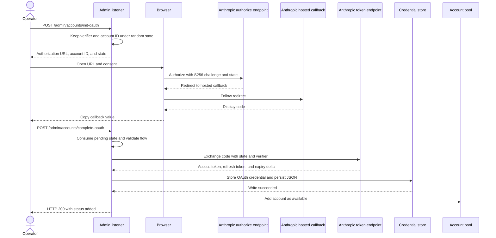

# OAuth Enrollment and Account Replacement

Enrollment adds a subscription account to the running proxy without a restart. Use the [account runbook’s port-forward instructions](../../docs/runbook/accounts.md#accessing-the-admin-api) to reach the admin API and its [PKCE steps](../../docs/runbook/accounts.md#adding-an-account-pkce-flow) for the operator commands.

## Admin access and browser handoff

The service starts a separate admin listener only in OAuth pool mode (`[oauth]` present) and with `[admin].enabled = true`. It uses `[admin].listen_addr` (default `0.0.0.0:9090`). Kubernetes exposes port `9090` through a dedicated ClusterIP service; the Tailscale Ingress targets the inference service, not the admin service. The admin router does not install an authentication check, so keep access restricted. An admin bind failure is logged without stopping the main listener; a working inference endpoint does not prove admin is reachable. See [Service Runtime](../architecture/service-runtime.md) for listener ownership.

*Successful PKCE enrollment: the hosted callback displays the value for manual completion, and the proxy persists credentials before adding the account to the pool.*

The active [OAuth constants](../../crates/anthropic-auth/src/constants.rs) send the browser to `https://claude.ai/oauth/authorize`, use `https://platform.claude.com/oauth/code/callback` as the redirect URI, and send exchange and refresh requests to `https://platform.claude.com/v1/oauth/token`. The hosted callback does not call the proxy’s admin listener. The authorization URL carries the public client ID, `code=true`, `response_type=code`, the S256 challenge, and the subscription scopes (`user:profile`, `user:inference`, `user:sessions:claude_code`, `user:mcp_servers`), not the Console API-key creation scope. The token exchange is a form POST with `grant_type=authorization_code`, the code, state, original `code_verifier`, public client ID, and the same redirect URI.

### Pending state and retries

`init-oauth` generates the verifier and OAuth `state` independently, each from 32 random bytes encoded as 43 unpadded base64url characters. The browser gets the challenge, not the verifier. The admin process keeps the verifier, generated account ID, and creation time in memory, keyed by the opaque state rather than the account ID. The flow has a ten-minute window; new init calls prune expired entries. Complete on the same running instance: restarting the pod loses pending flows even though persisted credentials survive. The shipped deployment uses one replica.

`complete-oauth` accepts JSON with `code` containing `code#state`, or a bare `code` and a separate `state` field. A suffix takes precedence. An optional `account_id` must match the ID saved by init; it does not select an account to overwrite. Missing or unknown state, an ID mismatch, or expired state returns `400`. A matching state is removed **before** the ID and age checks, token exchange, and storage. Even a mismatched ID, an exchange failure (`502`), or a storage failure (`500`) after lookup consumes it. Start over with `init-oauth` rather than replaying the callback. Account IDs are derived from the Unix second at init, so keep separate enrollments out of the same second: completing both would write to the same credential key, despite their distinct state values.

## Persistence and pool membership

The admin handler converts the returned `expires_in` (seconds until access-token expiry) to `expires` (absolute Unix milliseconds) and stores the access and refresh tokens under the flow’s account ID as an OAuth credential. The shared `CredentialStore` serializes mutations and writes the JSON via a same-directory temporary file and atomic rename, with `0600` permissions on Unix. It changes its in-memory map *before* writing. If the write fails, completion returns `500` and skips the pool addition, but the credential mutation is not rolled back in memory.

After a successful write, the handler sets the account to `available` in the live pool and returns `status: added`. Enrollment changes runtime membership and the credential file, not `[oauth].providers`. At startup, the pool is seeded from saved credential IDs when `providers` is empty (the shipped setting); a nonempty list overrides those IDs. The deployment mounts `/data` from a PersistentVolumeClaim for `/data/credentials.json`. The pool reads tokens from the shared store when selecting an account; runtime pool status is not stored with those tokens. See [Account Pool](../concepts/account-pool.md) for selection and refresh behavior.

## Inspect and remove accounts

| Endpoint | What it reports or changes |
| --- | --- |
| `GET /admin/accounts` | The pool’s account rows only: `id`, `status` (`available`, `cooling_down`, or `disabled`), and remaining cooldown seconds when applicable. No tokens. |
| `GET /admin/pool` | The same token-free rows plus counts and aggregate status: `healthy` when all accounts are available and the pool is nonempty, `degraded` when only some are available, and `unhealthy` when none are. HTTP `200` is not a health verdict. |
| `DELETE /admin/accounts/{id}` | Removes the ID and status from the live pool first, then removes the in-memory credential and attempts to persist the change. This is local deletion, not grant revocation at Anthropic. An absent ID succeeds too. |

**Deletion is not a durability check.** A credential write failure produces a warning but the endpoint still returns `200` with `status: removed`. The live pool entry stays removed, but the old credential can remain on disk and be loaded again at startup. Repeating DELETE is not a disk repair: the store only writes on removal if the credential existed in its in-memory map. Check logs for the persistence warning before treating deletion as permanent.

## Replace a disabled account

Both background and request-time refresh disable the account on a permanent token rejection (`invalid_grant` or HTTP `401`/`403`); transient refresh errors do not disable it. A restart with the same credential cannot restore an expired grant. PKCE gives the proxy a separate refresh-token lineage from the local Claude Code login, but it does not establish a longer lifetime. The [runbook’s observed grant lifetimes](../../docs/runbook/accounts.md#refresh-token-lifetime-and-re-auth) put recent PKCE failures near 30 days. Use that as a planning window for browser consent, not a guaranteed TTL or the lifetime of an access token or pending PKCE state.

<!-- openwiki: broken internal link [../operations/diagnose-the-proxy.md] file "../operations/diagnose-the-proxy.md" does not exist. Fix the href or restore the target, then delete this comment. -->
Follow the runbook: [port-forward to admin](../../docs/runbook/accounts.md#accessing-the-admin-api), [enroll a replacement via PKCE](../../docs/runbook/accounts.md#adding-an-account-pkce-flow), and confirm the new entry is `available` in `/admin/pool` before [removing the disabled entry](../../docs/runbook/accounts.md#removing-an-account) by its exact ID. Then check the proxy’s `/health` **body** and make an end-to-end client request. `available` is a pool status, not proof of inference success. If service is still failing, see [Diagnose the Proxy](../operations/diagnose-the-proxy.md) and the [pool-exhaustion runbook](../../docs/runbook/troubleshooting.md#pool-exhausted-oauth-mode).

## Validation when changing the flow

The [admin router tests](../../services/oauth-proxy/src/admin.rs) cover the random state and `code=true` request shape, missing or unknown state, expiry, consumption on ID mismatch, token-free listings, and deletion of present and absent entries. The [PKCE](../../crates/anthropic-auth/src/pkce.rs) tests pin the verifier and challenge encoding, the [credential store tests](../../crates/anthropic-auth/src/credentials.rs) check reload, Unix permissions, and concurrent writes, and the [token tests](../../crates/anthropic-auth/src/token.rs) pin the token URL and permanent refresh-error classification. These checks do not exercise successful hosted consent. Use the PKCE runbook for that handoff and see [Validation](../testing/validation.md) for the deployed client smoke check.
