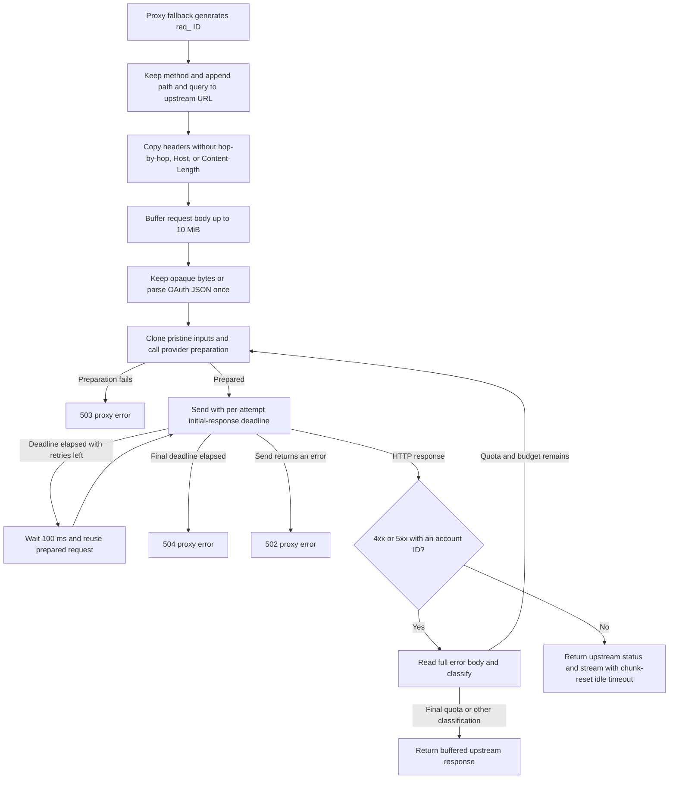

# Proxy Requests, Retries, and Streaming

The proxy has two separate attempt loops. An **initial-response timeout** replays the prepared request on the same credentials. A **subscription-quota response** can start a new account attempt. Once the proxy returns a streaming response, neither loop can restart it.

## From the listener to the first send

The Axum router sends fallback traffic to `proxy_handler` under `[proxy].max_connections`. The local `GET /health` and `GET /metrics` routes bypass that limit. The handler generates a fresh `req_` ID for tracing and proxy-generated errors; it does not add that generated ID as an HTTP header. The provider handles **upstream** authentication, not an inbound login in the forwarding handler. See [Service Runtime](../architecture/service-runtime.md) for the listener and deployment boundaries.

*Figure: The proxy reuses prepared bytes for timeout retries, starts fresh for quota failover, and only applies the idle timeout to the streamed response path. Request body or JSON errors return 400 before provider preparation.*

[`proxy_request`](../../services/oauth-proxy/src/proxy.rs) appends the original path and query to `[proxy].upstream_url` after trimming trailing slashes from the base. It copies header values with `append` so repeated values survive the initial copy. It removes the fixed hop-by-hop header list, `Host`, and `Content-Length`: the HTTP client constructs the upstream host and frames the actual outgoing body rather than reusing a length that OAuth rewriting could invalidate. In either mode, the request body is fully buffered with an inclusive **10 MiB** cap. Read failures or an oversized body get **400**, not 413; an OAuth body that cannot be parsed as JSON also gets 400 before any upstream send.

| Mode | Preparation and outgoing body |
| --- | --- |
| **Passthrough** (no `[oauth]`) | Keeps the body as opaque bytes, even if it is not JSON. Applies configured `[[headers]]` but never injects or replaces `Authorization`. Returns no account ID. |
| **OAuth pool** (`[oauth]` present) | Ignores static `[[headers]]`. Parses the original JSON once. On each account attempt, selects a pool token, removes client `Authorization` and `x-api-key`, injects the selected Bearer token, merges Anthropic beta flags, applies the provider's compatibility headers and system-prompt edits, and sends the reserialized body. See the [Anthropic Client Contract](../integrations/anthropic-client-contract.md) for the wire rules. |

The [`Provider` interface](../../crates/provider/src/lib.rs) separates request preparation and account/error policy from HTTP mechanics. `needs_body` controls parsing; `prepare_request` mutates per-attempt copies of the filtered headers and, in OAuth mode, the original parsed JSON. Mutations from a previous account attempt never become input to the next. The optional account ID from preparation determines whether the proxy invokes `classify_error` and which account it passes to `report_error`.

## Initial-response retries and quota failover

- **Connect:** The shared reqwest client has a fixed **5-second connect timeout**. If `req.send()` returns an error first (for example, a refused connection or a reqwest connect timeout), the proxy returns **502** immediately. It does not retry based on reqwest's error type.
- **Initial response:** Each send has its own `[proxy].timeout_secs` deadline around `req.send()`, covering the send through receipt of response status and headers. If that outer timer elapses, the proxy waits **100 ms** and replays the same method, URL, prepared headers and body without reselecting an account. Two retries means **three total sends** at most for that preparation; a third elapsed deadline returns **504**. The replay is not restricted to idempotent methods: a timeout does not prove that the upstream never received the request.
- **Account attempt budget:** At startup, passthrough gets one outer attempt; OAuth gets the number of initial account IDs, with a minimum of one. Those IDs come from `[oauth].providers`, or from the credential store if that list is empty. Admin enrollment adds an account to the live pool but does **not** recompute the budget in `ProxyState`. Each selection scans the current pool in round-robin order from a rotating start, skipping unavailable accounts and allowing expired cooldowns to become eligible. Selection can also refresh a near-expiry token inline, before the send timer starts. The handler keeps no per-request set of tried IDs, so the budget does not guarantee a different account on every attempt. See [Account Pool](../concepts/account-pool.md) for eligibility and refresh details.

When an upstream **4xx or 5xx** arrives with an account ID, the proxy reads the body before deciding what to return. The [quota classifier](../../crates/anthropic-pool/src/quota.rs) looks for known subscription-limit phrases such as `5-hour` or `usage limit for your plan` in a **429** body, case-insensitively. A match reports `QuotaExceeded`, puts the account in cooldown for `[oauth].cooldown_secs`, and repeats provider preparation only if the startup budget has another slot. A **401 or 403** reports `Permanent`, disables the account, and returns that upstream error immediately. Other errors, including a generic 429 and 5xx, are `Transient`: **return the upstream response without retry, failover, or a pool state change**.

If a quota response arrives on the final allowed account attempt, the proxy returns **that buffered upstream 429**. If selection instead fails before a send (including selection after an earlier quota response), `prepare_request` fails and the proxy returns **503** rather than falling back to the earlier 429. The same 503 path handles other preparation errors. Proxy-generated 400, 502, 503, and 504 responses use the JSON envelope `error.type = "proxy_error"` with `message` and `request_id`; there is no separate top-level `pool_exhausted` HTTP error type. An upstream response can have the same numeric status as a proxy-generated error, so check the body and logs rather than inferring the cause from status alone.

## Response body delivery and diagnosis

Both response builders preserve the upstream status and copy headers except for the fixed hop-by-hop list. Account-associated errors are buffered using `response.bytes()` before classification; this read is **outside** the send deadline and does **not** use the streaming idle wrapper. A body read error there leaves empty bytes for classification and any buffered return.

Other responses, including successful SSE and passthrough HTTP errors, go through `bytes_stream()` and `IdleTimeoutStream`. The same `timeout_secs` value (180 seconds by default and in the [committed Kubernetes configuration](../../k8s/config.toml)) now acts as a **body idle window**, not a total stream lifetime. Each successful byte chunk resets the deadline, independent of SSE event boundaries. After the original status and headers are handed back, an idle expiry logs `upstream idle timeout` and ends the body with EOF: no replacement 504, injected SSE error event, or replay. A body transport error is propagated as a stream error, not converted into that idle EOF.

<!-- openwiki: broken internal link [../operations/diagnose-the-proxy.md] file "../operations/diagnose-the-proxy.md" does not exist. Fix the href or restore the target, then delete this comment. -->
For a partial stream with a 200, check the idle warning even if the request metrics show success: the handler records request duration and releases its in-flight counter at response return, not at the end of body streaming. For 502 versus 504, look at `proxy_upstream_errors_total` (`connection` versus `timeout`). For provider 503, check OAuth pool health and the `provider prepare_request failed` log. A quota event can increment `pool_failovers_total` even on the final slot, so the counter alone does not prove a second account was reached. See [Diagnose the Proxy](../operations/diagnose-the-proxy.md) for operational checks and the [streaming timeout spec](../../specs/streaming-timeout-fix.md) for why the old whole-response timeout was removed.

## Regression checks

The [local mock-upstream tests](../../services/oauth-proxy/src/main.rs) exercise the router and real upstream HTTP transport without Anthropic credentials. Run individual cases with `cargo test -p oauth-proxy <test-name>`; see [Validation](../testing/validation.md) for broader checks.

| What to check | Representative evidence |
| --- | --- |
| Request integrity | [`proxy_query_string_forwarded_to_upstream`](../../services/oauth-proxy/src/main.rs#L954-L983) checks the path and query; the [over-limit](../../services/oauth-proxy/src/main.rs#L1303-L1346) and [exact-limit](../../services/oauth-proxy/src/main.rs#L1694-L1723) cases pin the body cap. The [OAuth preparation seam test](../../services/oauth-proxy/tests/inc_2026_001_seam.rs) checks credential replacement and preservation of non-system JSON. |
| 502 versus 504 | [`proxy_does_not_retry_non_timeout_errors`](../../services/oauth-proxy/src/main.rs#L1472-L1519) closes the socket and asserts one connection and 502. [`proxy_retries_timeout_exactly_three_attempts`](../../services/oauth-proxy/src/main.rs#L1406-L1470) stalls before headers and asserts three attempts and 504. [`proxy_resends_body_on_timeout_retry`](../../services/oauth-proxy/src/main.rs#L2263-L2367) checks that the repeated POST carries the original body. |
| OAuth classification | [`oauth_provider_quota_failover`](../../services/oauth-proxy/src/main.rs#L3188-L3266) asserts two calls for a quota 429 followed by a 200; the [permanent-error case](../../services/oauth-proxy/src/main.rs#L3268-L3325) asserts one call and a returned 401. Despite its name, [`oauth_provider_pool_exhausted_returns_503`](../../services/oauth-proxy/src/main.rs#L3327-L3378) asserts **429** on the one-account final slot. The [pool selection test](../../crates/anthropic-pool/src/pool.rs#L558-L583) separately checks selection failure with no eligible account. |
| Idle after headers | [`proxy_stream_idle_timeout_terminates_stalled_stream`](../../services/oauth-proxy/src/main.rs#L3418-L3533) sends 200 and two SSE chunks, then holds the upstream socket open. The proxy keeps the 200 and both chunks, and the body finishes without waiting for the upstream socket to close. |
